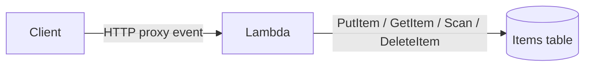

# Lab 01: Serverless API

API Gateway–style Lambda proxy + DynamoDB CRUD on LocalStack.

## Architecture



## Learning goals

- Implement a Lambda proxy handler that routes by `httpMethod` and path parameters
- Persist items in DynamoDB (`id` partition key)
- Return correct status codes: 200, 201, 204, 400, 404
- Include CORS headers for browser clients

## Problem

Edit `starter.py`:

1. **`ensure_table(dynamodb, table_name)`** — create a DynamoDB table with partition key `id` (String) if it does not exist; wait until active.
2. **`api_handler(event, context)`** — handle:
   - `GET` (no id) → scan table, return `{ "items": [...] }` with 200
   - `GET` with `pathParameters.id` → get item; 200 or 404
   - `POST` with JSON body `{ "name": "..." }` → put item with generated `id`; 201 (400 if `name` missing)
   - `DELETE` with id → delete item; 204
3. **`cors_headers()`** — return headers including `Access-Control-Allow-Origin: *` and allow GET/POST/DELETE/OPTIONS.

Use `common.aws_client.get_client` (or accept injected clients in helpers — tests pass a DynamoDB client).

## Exam tips

- Lambda **proxy integration** receives `httpMethod`, `pathParameters`, and a **string** `body`.
- Prefer **idempotent** deletes (204 even if already gone) only when the product requires it; here return 204 after a successful delete of an existing item (404 if missing is also acceptable — follow the tests).
- Least privilege: the function role needs only the DynamoDB actions used by this API.

## Prerequisites

```bash
docker compose up -d
export AWS_ENDPOINT_URL=http://localhost:4566
export AWS_ACCESS_KEY_ID=test
export AWS_SECRET_ACCESS_KEY=test
export AWS_DEFAULT_REGION=us-east-1
```

## Run

```bash
python runner.py labs/01-serverless-api
python runner.py labs/01-serverless-api --solution
```

Offline concept check: [exercises/31-serverless-api](../exercises/31-serverless-api/).
