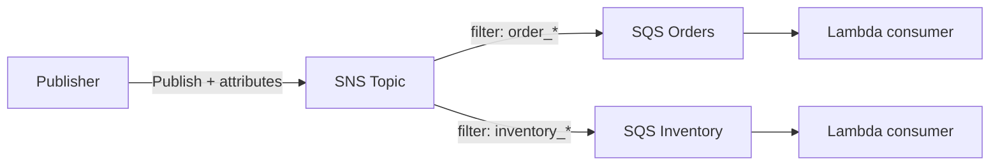

# Lab 02: Event-Driven Fan-Out

SNS → SQS fan-out with filter policies, then a Lambda-style SQS consumer on LocalStack.

## Architecture



## Learning goals

- Create an SNS topic and multiple SQS queues
- Subscribe queues with SNS **filter policies** on message attributes
- Publish events with attributes so only matching queues receive them
- Process SQS messages in a Lambda-style handler (idempotent-friendly)

## Problem

Edit `starter.py`:

1. **`setup_fanout(sns, sqs, topic_name, subscriptions)`** — create topic + queues; for each subscription `{ "queue_name", "filter_policy" }` subscribe the queue with protocol `sqs` and that filter policy. Return `{ "topic_arn", "queues": { name: { "url", "arn" } } }`.
2. **`publish_event(sns, topic_arn, event_type, data)`** — publish JSON body; set message attribute `event_type` (String) for filtering.
3. **`sqs_handler(event, context)`** — process API Gateway-style… no: process an **SQS** Lambda event (`Records` with `body`); return `{ "processed": N }` where N is the number of records. Parse each body as JSON.

## Exam tips

- SNS filter policies match **message attributes** (not the body) unless you use payload-based filtering.
- Fan-out to SQS requires a **queue policy** allowing `sns:Publish` from the topic (LocalStack often relaxes this; real AWS does not).
- Prefer **idempotent** consumers — SNS/SQS can deliver duplicates.

## Prerequisites

```bash
docker compose up -d
export AWS_ENDPOINT_URL=http://localhost:4566
export AWS_ACCESS_KEY_ID=test
export AWS_SECRET_ACCESS_KEY=test
export AWS_DEFAULT_REGION=us-east-1
```

## Run

```bash
python runner.py labs/02-event-driven
python runner.py labs/02-event-driven --solution
```

Offline concept check: [exercises/32-event-driven](../exercises/32-event-driven/).
