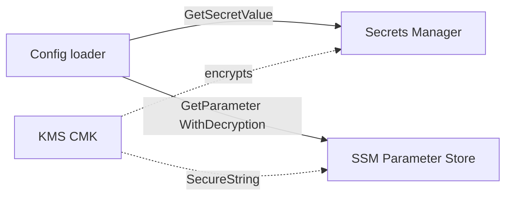

# Lab 04: Secure Config

Lambda-style config loader reading Secrets Manager and SSM Parameter Store, with a KMS-encrypted secret on LocalStack.

## Architecture



## Learning goals

- Create a KMS key and store a Secrets Manager secret encrypted with that key
- Put an SSM `SecureString` parameter (optionally with `KeyId`)
- Load both at runtime (cache-friendly pattern) for a Lambda handler
- Prefer Secrets Manager for rotating credentials; SSM for config hierarchy

## Problem

Edit `starter.py`:

1. **`create_kms_key(kms, description)`** — create a CMK; return `KeyId`.
2. **`store_secret(secrets, name, secret_dict, kms_key_id)`** — `CreateSecret` with JSON string and `KmsKeyId`; return ARN.
3. **`put_secure_parameter(ssm, name, value, kms_key_id)`** — `PutParameter` Type `SecureString` with `KeyId`.
4. **`load_app_config(secrets, ssm, secret_id, param_name)`** — return `{ "secret": {...}, "param": "..." }` with decrypted values.

## Exam tips

- Grant the Lambda role **least privilege**: `secretsmanager:GetSecretValue`, `ssm:GetParameter`, and `kms:Decrypt` on specific ARNs.
- Cache secrets in the **execution environment** (module globals) to reduce API calls and latency; refresh on rotation errors.
- SSM `SecureString` vs Secrets Manager: rotation / cross-account / automatic RDS integration favor Secrets Manager.

## Prerequisites

```bash
docker compose up -d
export AWS_ENDPOINT_URL=http://localhost:4566
export AWS_ACCESS_KEY_ID=test
export AWS_SECRET_ACCESS_KEY=test
export AWS_DEFAULT_REGION=us-east-1
```

## Run

```bash
python runner.py labs/04-secure-config
python runner.py labs/04-secure-config --solution
```

Related offline checks: [exercises/19-secrets](../exercises/19-secrets/), [exercises/18-kms-encryption](../exercises/18-kms-encryption/), [exercises/34-multi-auth](../exercises/34-multi-auth/) (auth concept — this lab is the multi-service security hands-on).
